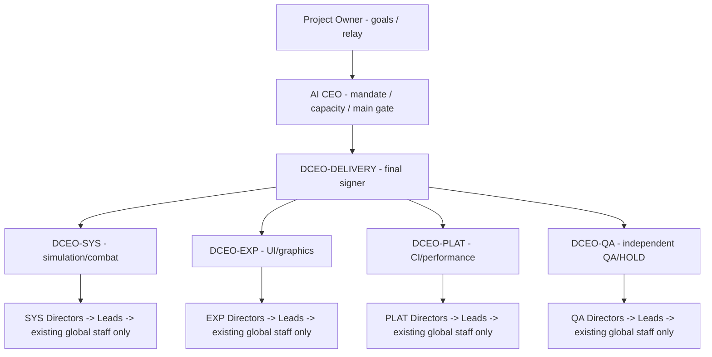

# Ant Kingdom — Team Map / Current command chain

**กฎปฏิบัติล่าสุด:** [FAST-LANE-GOVERNANCE](../FAST-LANE-GOVERNANCE.md). การแต่งตั้งแบบ 1 Issue + 1 ACK ไม่ต้องรอ Relay เพื่อ Sync ทะเบียนก่อนเปิดตำแหน่งลูกน้องภายใน Slot ที่อนุมัติ. สามารถถาม/ประสานงานจริงข้ามทีมได้โดยตรง; งานแก้โค้ดต่าง Scope ต้องมีเจ้าของรับรอง. สถานะ ACTIVE ตาม JSON ต้องมาจาก ACK จริง, ไม่เดาขึ้นเอง.

**Current state: COLONY-NEXT-01 / 10 REGISTRY ACTIVE + 4 UNRECONCILED LEAD ACKs / GLOBAL STAFFING FREEZE / IMPLEMENTATION_HOLD.** CEO, DCEO-DELIVERY, four Domain Deputies and four Directors have personal receiving-chat ACK evidence and direct-parent accepted appointment in governance Issues #5/#6/#9–#12/#16–#19. No Team Lead or Engineer is ACTIVE in the merged JSON roster; HOWEVER four Team Leads have separately acknowledged in actual GitHub Issues and must be reconciled before a <=10 global headcount claim. Game main is unchanged at `7d2458a13154716b09649903d1b26c86c8848845`; no COLONY-NEXT-01 game implementation is authorized.

**Registry version:** `GOV-V2-COLONY-NEXT-01-006` (CEO, Delivery, four Deputies and four Directors personally ACKed/accepted; next Team Lead appointments unissued)

**ชื่อแชทของทุก Role:** `<ROLE_ID>` จากคำสั่งแต่งตั้งจริง; ดู [Chat Naming](../CHAT-NAMING.md). AI ต้องเสนอชื่อทันทีที่ ACK แต่ไม่มีคำสั่ง Rename ChatGPT โดยตรงใน GitHub Connector.

**เริ่มงาน AI ใหม่:** [คู่มือ Role Start](../ROLE-START-HERE.md) · [ทักษะแต่ละบทบาท](../ROLE-SKILLS-AND-SCOPE.md) · [วิธีส่งต่องาน](../TASK-STATE-AND-HANDOFF.md) · [Owner Relay](../RELAY-TEMPLATES.md). ทุก AI ต้อง ACK เครื่องมือและขอบเขตก่อนรับงานจริง.

**Machine-readable live roster:** [TEAM-REGISTRY.json](TEAM-REGISTRY.json) · [Signed Release Board](RELEASE-SIGNATURES.md) · [Governance V2 charter](../V2-GOVERNANCE.md)

**GLOBAL CAP: [10 AI FOR THE ENTIRE ORGANIZATION](../TEAM-CAPACITY-AND-MANAGEMENT-CONTRIBUTORS.md), NOT PER TEAM.** Count CEO, Delivery, Deputies, Directors, Leads, Engineers, Assistants, standby roles and all verified but not yet reconciled appointment ACKs. No 11th AI for huge work or multi-team structures. CEO/Delivery consolidates duties; qualified managers may implement scoped tasks with independent review.

## Approved chain / staffing blueprint (CEO + DELIVERY + FOUR DEPUTIES + FOUR DIRECTORS ACKed; Leads/Engineers are not on the registered ACTIVE roster; four Lead ACKs remain unresolved)

**Schematic only:** each of the four Director nodes represents a **separate position class in its own domain**, not an individual appointment. Every real Director/Lead/Engineer/Assistant must have exactly one `parent_role_id` in the JSON when appointed. Formal code ownership remains under an accountable manager. Real technical consultations and urgent blocker notices may go directly to a related active role across any level; out-of-scope writes need affected file owner's acceptance.

**AI ใหม่ได้เพียง Repo URL ยังรู้ Role ไม่ได้:** ผู้จัดการตรงต้องส่ง [Activation Packet](../ACTIVATION-PACKET.md) ที่มี Role ID, Parent และ Issue แต่งตั้ง; Task จริงใช้ [Task Issue Contract](../TASK-ISSUE-CONTRACT.md). โปรดอ่าน [Readiness Drills](../READINESS-DRILLS.md) และตรวจ Tool Access ก่อนเปิดทำงาน.

## Skill/Authority cards — ทุก Role ต้องอ่านก่อน ACK

| Slot | Role Charter | Mandatory Skill Check | Next Recipient หลังงาน |
| --- | --- | --- | --- |
| CEO | [CEO](../../roles/CEO.md) | PR metadata, staffing, Release Gate | Project Owner |
| DCEO-DELIVERY | [Delivery](../../roles/DEPUTY-DELIVERY.md) | Integration/sha/signature | CEO |
| DCEO-SYS | [Domain Deputy](../../roles/DEPUTY-DOMAIN.md) | Simulation & gameplay invariants | DCEO-DELIVERY |
| DCEO-EXP | [Domain Deputy](../../roles/DEPUTY-DOMAIN.md) | HUD/render/mobile/Thai | DCEO-DELIVERY |
| DCEO-PLAT | [Domain Deputy](../../roles/DEPUTY-DOMAIN.md) | CI/build/performance | DCEO-DELIVERY |
| DCEO-QA | [Independent QA](../../roles/DEPUTY-QUALITY.md) | Independent tests/artifacts/HOLD | DCEO-DELIVERY |
| Directors/Leads/Engineers | [Directors](../../roles/DEPARTMENT-DIRECTOR.md) · [Leads](../../roles/TEAM-LEAD.md) · [Engineers](../../roles/ENGINEER.md) | [Skills & Scope](../ROLE-SKILLS-AND-SCOPE.md) | **หัวหน้าตรงในทะเบียนจริง** |
| Assistant/Roster Steward | [Assistant](../../roles/ASSISTANT.md) · [Roster](../../roles/ROSTER-STEWARD.md) | Approved task/organization schema | **ผู้จัดการตรงในทะเบียนจริง** |

**ทุกแชทต้องตรวจ GitHub Tool/CI/Skill ที่ใช้ได้จริงด้วยตัวเอง, โพสต์ APPOINTMENT_ACK, และใช้ [ข้อความส่งต่องาน](../RELAY-TEMPLATES.md).** รายการนี้เป็นสัญญา Skill ของตำแหน่ง **ไม่ใช่หลักฐานว่าบุคคลใหม่ได้รับงานหรือเครื่องมือแล้ว**. หลังงานจบ ถ้าไม่มีคำสั่งใหม่ → STANDBY.

## Actual appointments — personal ACK + direct-parent acceptance verified from GitHub
| Role ID | Immediate parent | Personal ACK | Parent validation / organizational authority |
| --- | --- | --- | --- |
| `CEO` | `Project Owner` | [ACK](https://github.com/tanawutmalirum29-ux/appointment-CEO/issues/5#issuecomment-6157635338) | [Accepted](https://github.com/tanawutmalirum29-ux/appointment-CEO/issues/6#issuecomment-6157968920) — `ACTIVE / ORG_SETUP_ONLY / IMPLEMENTATION_HOLD` |
| `DCEO-DELIVERY` | `CEO` | [ACK](https://github.com/tanawutmalirum29-ux/appointment-CEO/issues/6#issuecomment-6157936418) | [Accepted](https://github.com/tanawutmalirum29-ux/appointment-CEO/issues/6#issuecomment-6157968920) — `ACTIVE / ORG_SETUP_ONLY / IMPLEMENTATION_HOLD` |
| `DCEO-SYS` | `DCEO-DELIVERY` | [ACK](https://github.com/tanawutmalirum29-ux/appointment-CEO/issues/9#issuecomment-6158081984) | [Accepted](https://github.com/tanawutmalirum29-ux/appointment-CEO/issues/9#issuecomment-6158183714) — `ACTIVE / ORG_SETUP_ONLY / IMPLEMENTATION_HOLD` |
| `DCEO-EXP` | `DCEO-DELIVERY` | [ACK](https://github.com/tanawutmalirum29-ux/appointment-CEO/issues/10#issuecomment-6158081848) | [Accepted](https://github.com/tanawutmalirum29-ux/appointment-CEO/issues/10#issuecomment-6158184263) — `ACTIVE / ORG_SETUP_ONLY / IMPLEMENTATION_HOLD` |
| `DCEO-PLAT` | `DCEO-DELIVERY` | [ACK](https://github.com/tanawutmalirum29-ux/appointment-CEO/issues/11#issuecomment-6158090772) | [Accepted](https://github.com/tanawutmalirum29-ux/appointment-CEO/issues/11#issuecomment-6158184729) — `ACTIVE / ORG_SETUP_ONLY / IMPLEMENTATION_HOLD` |
| `DCEO-QA` | `DCEO-DELIVERY` | [ACK](https://github.com/tanawutmalirum29-ux/appointment-CEO/issues/12#issuecomment-6158094709) | [Accepted](https://github.com/tanawutmalirum29-ux/appointment-CEO/issues/12#issuecomment-6158185570) — `ACTIVE / ORG_SETUP_ONLY / IMPLEMENTATION_HOLD` |
| `SYS-DIR1` | `DCEO-SYS` | [ACK](https://github.com/tanawutmalirum29-ux/appointment-CEO/issues/16#issuecomment-6158297046) | [Accepted](https://github.com/tanawutmalirum29-ux/appointment-CEO/issues/16#issuecomment-6158323793) — `ACTIVE / ONE direct Team Lead authorized; legacy registry-sync wait superseded by Fast Lane / IMPLEMENTATION_HOLD` |
| `EXP-DIR` | `DCEO-EXP` | [ACK](https://github.com/tanawutmalirum29-ux/appointment-CEO/issues/18#issuecomment-6158299961) | [Accepted](https://github.com/tanawutmalirum29-ux/appointment-CEO/issues/18#issuecomment-6158337385) — `ACTIVE / ONE direct Team Lead authorized; legacy registry-sync wait superseded by Fast Lane / IMPLEMENTATION_HOLD` |
| `PLAT-DIR` | `DCEO-PLAT` | [ACK](https://github.com/tanawutmalirum29-ux/appointment-CEO/issues/17#issuecomment-6158307027) | [Accepted](https://github.com/tanawutmalirum29-ux/appointment-CEO/issues/17#issuecomment-6158346850) — `ACTIVE / ONE direct Team Lead authorized; legacy registry-sync wait superseded by Fast Lane / IMPLEMENTATION_HOLD` |
| `QA-DIR` | `DCEO-QA` | [ACK](https://github.com/tanawutmalirum29-ux/appointment-CEO/issues/19#issuecomment-6158321086) | [Accepted](https://github.com/tanawutmalirum29-ux/appointment-CEO/issues/19#issuecomment-6158360737) — `ACTIVE / ONE direct Team Lead authorized; legacy registry-sync wait superseded by Fast Lane / IMPLEMENTATION_HOLD` |

**Capacity override:** Previously approved 22 slots are **SUPERSEDED** by Owner global hard cap of 10, not an invitation to fill 12 optional places. Registered roles = 10 ACTIVE; [SYS-TL1 #21](https://github.com/tanawutmalirum29-ux/appointment-CEO/issues/21), [EXP-TL1 #22](https://github.com/tanawutmalirum29-ux/appointment-CEO/issues/22), [PLAT-TL1 #23](https://github.com/tanawutmalirum29-ux/appointment-CEO/issues/23), [QA-TL1 #24](https://github.com/tanawutmalirum29-ux/appointment-CEO/issues/24) **have real ACKs not reconciled into JSON**. **NO NEW AI APPOINTMENTS** until CEO/Delivery establishes which at-most-10 individuals remain in the organization with real retirement/handoff records.

**Historical capacity (archived authority only):** `CAP-COLONY-NEXT-01-22` originally allowed 22 role slots, but this is **revoked as an operative hiring budget** by the Owner's GLOBAL MAX 10. Do NOT appoint the other Lead/Engineer slots. `appointments[]` has 10 registered ACK-backed roles; `unreconciled_verified_ack_issues[]` records four more genuine Lead ACKs requiring an honest CEO/Delivery disposition.

**Director org deltas processed together:** [SYS-DIR1 source ACK #16](https://github.com/tanawutmalirum29-ux/appointment-CEO/issues/16#issuecomment-6158297046) and [parent accepted](https://github.com/tanawutmalirum29-ux/appointment-CEO/issues/16#issuecomment-6158323793); [EXP-DIR source ACK #18](https://github.com/tanawutmalirum29-ux/appointment-CEO/issues/18#issuecomment-6158299961) and [parent accepted](https://github.com/tanawutmalirum29-ux/appointment-CEO/issues/18#issuecomment-6158337385); [PLAT-DIR source ACK #17](https://github.com/tanawutmalirum29-ux/appointment-CEO/issues/17#issuecomment-6158307027) and [parent accepted](https://github.com/tanawutmalirum29-ux/appointment-CEO/issues/17#issuecomment-6158346850); [QA-DIR source ACK #19](https://github.com/tanawutmalirum29-ux/appointment-CEO/issues/19#issuecomment-6158321086) and [parent accepted](https://github.com/tanawutmalirum29-ux/appointment-CEO/issues/19#issuecomment-6158360737). Direct Deputies reported each accepted Director through Issues #9–#12. No duplicate role/slot, and all four parents are active. HISTORICAL NEXT-HOP instruction now CANCELLED by GLOBAL STAFFING FREEZE: `SYS-DIR1→SYS-TL1`, `EXP-DIR→EXP Team Lead`, `PLAT-DIR→PLAT Team Lead`, `QA-DIR→QA Team Lead` — one each. The 4 Lead Issues have already been issued and acknowledged; no more AI chats may be appointed. CEO/Delivery must reconcile the actual 14 ACK-backed chats with a ten-person operational ceiling. Each separate Lead MUST send its own `APPOINTMENT_ACK` to its direct Director; registration remains Delivery's responsibility. No skip-level directions.

**IMPLEMENTATION_HOLD / RELEASE_HOLD:** no engineer product Tasks, code changes, product PR/QA PASS, new candidate, source SHA signatures, branch cleanup, or `ant-project/main` merge. `SIGNATURE_READY` machine gate is not implemented. Structural roster CI proves organizational syntax only, not ChatGPT actor identity or gameplay quality. Shared integration entrypoint path leases for `src/core/game.js`, `src/main.js`, `src/ui/app.js` remain unissued.

## Rules for the Roster Steward
1. Owner/CEO approves governance and round staffing envelope. CEO appoints Delivery; Delivery appoints domain Deputies; Deputies appoint Directors; Directors appoint Leads; Leads appoint only contributors actually needed; the ENTIRE organization has a maximum of 10 AI, even across multiple work teams. No mandatory two Engineers.
2. Real chat receives appointment via Owner's short relay and posts `APPOINTMENT_ACK` with Issue permalink. Only then add a row with `ACTIVE`. A proposed role slot is NOT an activated person.
3. Direct managers report verified ACK deltas directly to Delivery/Roster Steward and the steward batches edits to this page and `TEAM-REGISTRY.json`; inspect unique IDs, parent links, cycles, scope ownership and current Task Issues before saving. Show the **registry_version**, actual changed roles and signed update URL.
4. Every signed candidate SHA belongs on separate [Release Signature Board](RELEASE-SIGNATURES.md); a roster row is not a release signature. Signatures are invalid if release HEAD changes.
5. For rapid roster maintenance, Delivery may propose a separate `org/registry` branch **in appointment-CEO**, linked from this repository's `main`. Do not treat it as the live source until explicitly adopted; do not write organizational records into `ant-project/main`. All game-development source, Issues/PR and CI continue in `ant-project`.
